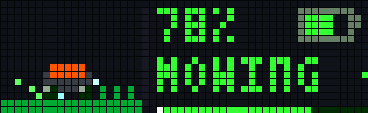
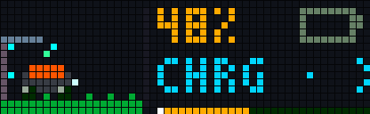
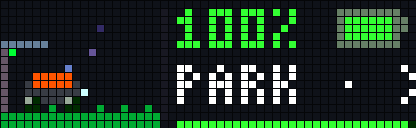
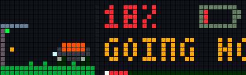
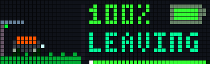
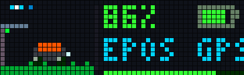
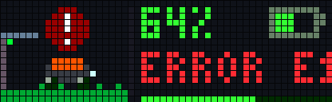

# Automower Live Diorama for AWTRIX (52x16)

[](Changelog.md)
[](https://github.com/Blueforcer/awtrix-light)
[-brightgreen.svg)](README.md)
[-yellow.svg)](automower.ax)
[](LICENSE)

An animated, real-time status monitor and pixel diorama for Husqvarna Automower robotic lawnmowers (including NERA and EPOS series) running natively on AWTRIX NG / Light LED matrix displays (specifically designed for the 52x16 canvas of the Ulanzi TC002).

Directly connects to the official Husqvarna Cloud API via OAuth2 client credentials. It splits the display into a 20x16 animated pixel diorama on the left and a rich telemetry dashboard on the right.

---

## Preview

### Diorama States

| State: Mowing | State: Charging |
|:---:|:---:|
|  |  |
| Sinusoidal glide across lawn, uncut grass blades ahead, rotating wheels, blade shimmer, and ejected clippings. | Docked in charging station with flowing cyan energy particles and animated battery fill. |

| State: Parked / Sleeping | State: Returning Home |
|:---:|:---:|
|  |  |
| Docked in station with floating sleep particles ("Zzz"). Displays restriction modes like Frost Guard. | Approaching dock along guide wire. |

| State: Leaving Dock | State: EPOS / Planning |
|:---:|:---:|
|  |  |
| Driving out of charging station towards mowing area. | Satellite radar sweeps during GPS acquisition or path computation. |

| State: Error / Stopped |
|:---:|
|  |
| Pulsing red beacon with exact Husqvarna error code (e.g. E12). |

---

## Key Features

- **7 Animated Diorama States:**
  - **Mowing:** Smooth horizontal sinusoidal motion, taller uncut grass blades ahead of the mower, rotating wheel spokes, spinning cutting disc shimmer, and ejected grass clipping particles.
  - **Charging:** Docked at charging station with animated energy flow particles entering the chassis.
  - **Parked / Sleeping:** Resting in charging dock with floating semi-transparent "Zzz" sleep particles. Supports special Husqvarna restrictions (Frost Guard, Daily Limit, All Work Areas Completed).
  - **Leaving Dock:** Moving forward out of the charging station onto the lawn.
  - **Going Home:** Driving towards the charging dock along the guide wire.
  - **EPOS / Planning:** Radar wave rings emitted from satellite icon while resolving RTK/GPS coordinates or planning paths.
  - **Error / Stopped:** Pulsing red warning beacon over the stationary mower, accompanied by the specific Husqvarna error code.

- **Real-Time Telemetry Dashboard (Right Zone):**
  - **Battery Percentage:** Digital readout with color transitions (green > 50%, orange 21-50%, red <= 20%).
  - **Battery Icon:** Dynamic level fill matching exact charge percentage, with an animated fill cycle while charging.
  - **Scrolling Status Line:** Displays current activity, mower name, restriction reasons, or next scheduled start time (e.g. `>08:00`).
  - **Bottom Progress Bar:** Visual battery progress bar with a traveling glow dot during active states.

- **Native Cloud Integration:**
  - Connects directly to the Husqvarna Authentication API and Automower Connect API via HTTPS.
  - Automatic token renewal and memory-efficient streaming regex parser tailored for ESP32 Berry runtime.

- **Interactive Manual Refresh:**
  - Press the middle button (select) on the clock at any time to immediately poll the Husqvarna API without waiting for the next timer cycle.

- **Error Alerting:**
  - Automatically wakes up the AWTRIX display and triggers an alert notification when the mower reports an error condition.

---

## Husqvarna API Setup

To connect the app to your mower, obtain free API credentials from the Husqvarna Developer Portal:

1. Visit the [Husqvarna Developer Portal](https://developer.husqvarnagroup.cloud/) and log in with your Automower Connect credentials.
2. Navigate to **My Applications** and click **Create Application**.
3. Name your application (e.g. `AWTRIX Automower`) and set the **Redirect URI** to `http://localhost`.
4. Under **Connected APIs**, connect both required APIs:
   - **Authentication API**
   - **Automower Connect API**
5. Save the application and copy your **Application Key** (Client ID) and **Application Secret**.

---

## Configuration

All parameters can be configured directly through the AWTRIX Web UI under the **Apps** tab by clicking the gear icon next to `Automower`:

| Setting | Key | Type | Default | Description |
|:---|:---|:---|:---|:---|
| App Key | `app_key` | Text | `""` | Application Key (Client ID) from the Husqvarna Developer Portal |
| App Secret | `app_secret` | Text | `""` | Application Secret from the Husqvarna Developer Portal |
| Mower Name | `mower_name` | Text | `""` | Optional mower name filter if multiple mowers exist in the account (leave empty for first mower) |
| Poll Interval | `every` | Number | `5` | Polling interval in minutes (5 min stays safely within the 10,000 monthly request limit) |
| Show Next Start | `show_next` | Bool | `true` | Appends the next scheduled start time (`>HH:MM`) when parked or charging |
| Alert on Error | `err_notify` | Bool | `true` | Wakes up the display and pushes a notification when an error occurs |
| Animation Speed | `anim_spd` | Slider | `100` | Playback speed percentage (25% to 200%) |
| Mower Accent Color | `body_col` | Color | `#FF6600` | Color of the mower top cover / accent line |
| Grass Color | `grass_col` | Color | `#00AA22` | Color of the lawn and grass blades |

---

## Installation

### Method 1: AWTRIX Web UI

1. Open your AWTRIX Web UI in your browser (`http://<awtrix-ip>` or `http://awtrixng-xxxxxx.local`).
2. Navigate to the **Scripts** tab.
3. Click **Add Script** and name it `automower`.
4. Copy the entire contents of [automower.ax](automower.ax) and paste it into the editor.
5. Click **Save**.
6. Switch to the **Apps** tab, click the gear icon next to `Automower`, enter your `App Key` and `App Secret`, and click **Save**.

### Method 2: HTTP API (Terminal / CLI)

Upload the script directly to your device via curl:

```bash
curl -X PUT "http://<awtrix-ip>/api/v1/apps/script/automower" \
  -H "Content-Type: text/plain" \
  --data-binary @automower.ax
```

---

## Error Codes Reference

When the mower stops unexpectedly, the diorama switches to the error state and displays `ERROR E<code>`. These codes correspond directly to official Husqvarna error numbers:

| Code | Husqvarna Name | Explanation / Resolution |
|:---|:---|:---|
| E1 | Outside working area | Mower drove outside the boundary wire. Relocate inside boundary and confirm. |
| E2 | No loop signal | Charging station powered off or boundary wire damaged / broken. |
| E4 | Loop sensor problem | Sensor issue or defective boundary connection. |
| E12 | Empty battery | Mower ran out of battery before reaching the dock. Carry to dock and confirm error on mower. |
| E16 | Trapped | Mower cannot move freely. Remove obstacles and confirm. |
| E28 | Manual stop | Stop button was pressed manually. |
| E701 | Searching for satellites | EPOS antenna looking for RTK reference or satellite fix. |

---

## Changelog

See [Changelog.md](Changelog.md) for version history.

---

## License

This project is licensed under the MIT License. See [LICENSE](LICENSE) for details.
